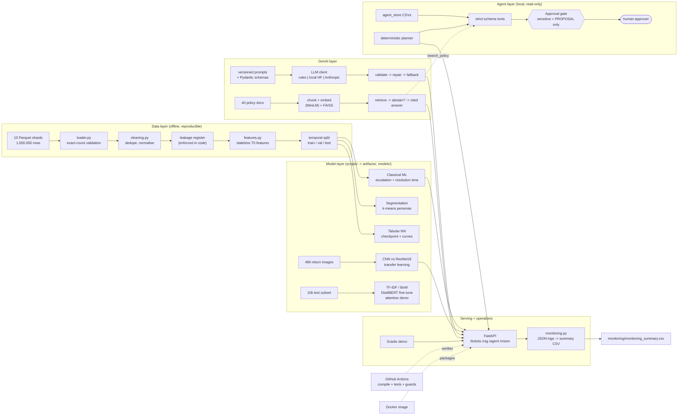

# Architecture

## 1. System view

The **approval boundary** is the diamond/hexagon in the agent layer: nothing downstream of it exists in the prototype — approved actions are
*recorded* as simulated executions with an approver identity, and no external system is ever called.

## 2. Component responsibilities

| Layer | Module | Responsibility | Key guarantee |
|---|---|---|---|
| Data | `omnisupport.data.loader` | discover/validate the ten shards | fails unless exactly 10 shards / 1,000,000 rows |
| Data | `omnisupport.data.cleaning` | rule-based cleaning with before/after report | only non-fitted rules; 1,000,000 → 996,000 unique tickets |
| Data | `omnisupport.data.leakage` | field register and guards | forbidden fields cannot reach `build_features` |
| Data | `omnisupport.data.features` | stateless T0 features + fit-on-train preprocessor | identical code for training and API |
| ML | `omnisupport.ml.*` | classification, regression, clustering, tabular NN | baselines, grouped CV, tuning, frozen test evaluation |
| Vision | `omnisupport.vision.*` | CNN and transfer learning | same stratified split and metrics for both |
| NLP | `omnisupport.nlp.*` | TF-IDF/BoW, embeddings, attention demo, pipelines, fine-tune | same held-out split for TF-IDF and transformer |
| LLM | `omnisupport.llm.*` | prompt registry, provider interface, validated structured outputs, benchmark | invalid output never escapes: repair → fallback → human review |
| RAG | `omnisupport.rag.*` | chunking, embeddings, FAISS index, retrieval, abstention, citations | answers only from retrieved text; no-answer when evidence is weak/conflicting |
| Agent | `omnisupport.agent.*` | tools, planner, trace, approval gate | sensitive actions are proposals; missing info is requested first |
| Serving | `app/api/main.py`, `app/ui/app.py`, `omnisupport.serving.*` | validated endpoints, UI, request logging | typed errors (4xx), no stack traces to clients |
| Ops | `omnisupport.serving.monitoring` | counters, latency, versions → CSV | every request produces a structured, redacted log line |

## 3. Request flows

1. **Ticket triage** `POST /tickets/predict` → validate with Pydantic → `build_features` (same code as training) → serving pipeline → probability, threshold decision, expected hours → advisory response + model version.
2. **Structured extraction** `POST /tickets/extract` → provider (rules by default) → JSON → Pydantic → on failure one repair attempt → deterministic fallback → `needs_human_review`.
3. **Policy question** `POST /rag/ask` → embed query → FAISS top-k → abstention check → cited extractive answer (or explicit no-answer reason) + retrieval trace.
4. **Agent request** `POST /agent/run` → deterministic plan → missing-info check → read-only tools → trace; sensitive intent → pending proposal. `POST /agent/approve` records a human decision against that proposal id.
5. **Vision** `POST /vision/predict` → path/extension/size validation (inside the allowed image folder only) → CNN/ResNet inference.

## 4. Versioning and rollback
`omnisupport.config` carries `MODEL_VERSION`, `PROMPT_VERSION`, `INDEX_VERSION`, `AGENT_VERSION`; they are written into every log line,
the monitoring summary, `models/*/metadata.json`, `artifacts/rag/index_metadata.json` and the prompt manifest. Rolling back = checkout the
previous tag of the model metadata/prompt manifest and rebuild the image (see `docs/monitoring_and_operations.md`).

## 5. Deployment
`deployment/Dockerfile` (python:3.12-slim, CPU-only dependency set `requirements-serve.txt`, non-root user, health check) →
`uvicorn app.api.main:app` on port 8000. `.github/workflows/tests.yml` compiles sources, runs the full non-heavy test suite and the repository
guard (no secrets / instructor files / raw data / oversized files) on every push and pull request.
