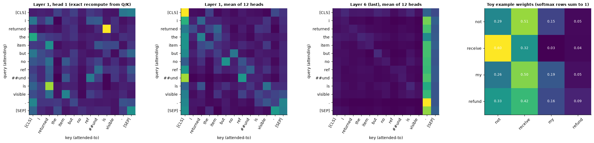
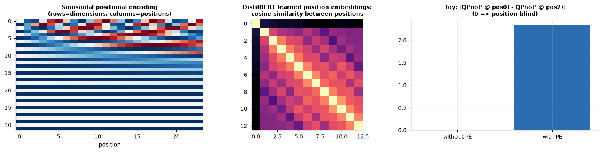

# Attention explained on one real support message (Session 20)

**Real message** (ticket `TKT000000520`): *"Can someone check this? I returned the item but no refund is visible. The order value is about GBP 149.40. Thank you. pls"*

To keep the matrices readable the walkthrough uses its first sentence: **"I returned the item but no refund is visible."**. All numbers below are produced by `scripts/09_attention.py` and stored in `artifacts/attention/`.

## 1. The idea in one paragraph
Each token is turned into three vectors by three learned matrices: a **query** (*what am I looking for?*), a **key** (*what do I offer to be found by?*) and a **value** (*what information do I hand over if I am attended to?*). The score between token *i* (query) and token *j* (key) is the dot product q·k, divided by √d_k so the softmax does not saturate. A softmax over *j* turns the scores of token *i* into weights that sum to 1, and the new representation of token *i* is the **weighted sum of all value vectors**. That is **self-attention**: every token rebuilds itself from all the other tokens in the same message, so *"refund"* can pull in information from *"no"* and *"returned"*. Attention itself has no notion of order — swapping two tokens just swaps two rows — so **positional information** is added to the token embeddings first.

## 2. Worked numerical example (4 tokens, d_model = 4, d_k = 2) — checkable by hand
Tokens taken from the message: `not receive my refund`. Embeddings E, the positional encoding PE (sinusoidal: PE[pos,2i]=sin(pos/10000^(2i/d)), PE[pos,2i+1]=cos(…)) and the input X = E + PE:

**E (embeddings)**
| | d0 | d1 | d2 | d3 |
|---|---|---|---|---|
| **not** | 1.00 | 0.00 | 1.00 | 0.00 |
| **receive** | 0.00 | 1.00 | 0.00 | 1.00 |
| **my** | 1.00 | 1.00 | 0.00 | 0.00 |
| **refund** | 0.00 | 1.00 | 1.00 | 0.50 |

**PE (position 0..3)**
| | d0 | d1 | d2 | d3 |
|---|---|---|---|---|
| **not** | 0.000 | 1.000 | 0.000 | 1.000 |
| **receive** | 0.841 | 0.540 | 0.010 | 1.000 |
| **my** | 0.909 | -0.416 | 0.020 | 1.000 |
| **refund** | 0.141 | -0.990 | 0.030 | 1.000 |

**X = E + PE**
| | d0 | d1 | d2 | d3 |
|---|---|---|---|---|
| **not** | 1.000 | 1.000 | 1.000 | 1.000 |
| **receive** | 0.841 | 1.540 | 0.010 | 2.000 |
| **my** | 1.909 | 0.584 | 0.020 | 1.000 |
| **refund** | 0.141 | 0.010 | 1.030 | 1.500 |

With small hand-chosen projection matrices W_Q, W_K, W_V (4×2, in `toy_example.json`): **Q = XW_Q**, **K = XW_K**, **V = XW_V**:

**Q**
| | q0 | q1 |
|---|---|---|
| **not** | 2.000 | 2.000 |
| **receive** | 0.851 | 3.540 |
| **my** | 1.929 | 1.584 |
| **refund** | 1.171 | 1.510 |

**K**
| | k0 | k1 |
|---|---|---|
| **not** | 2.000 | 2.000 |
| **receive** | 2.841 | 1.550 |
| **my** | 2.909 | 0.604 |
| **refund** | 1.641 | 1.040 |

**V**
| | v0 | v1 |
|---|---|---|
| **not** | 2.000 | 2.000 |
| **receive** | 0.851 | 1.550 |
| **my** | 1.929 | 0.604 |
| **refund** | 1.171 | 1.040 |

Scores QKᵀ (raw) then divided by √d_k = √2 = 1.414:

| | not | receive | my | refund |
|---|---|---|---|---|
| **not** | 5.657 | 6.211 | 4.968 | 3.791 |
| **receive** | 6.211 | 5.592 | 3.263 | 3.591 |
| **my** | 4.968 | 5.612 | 4.645 | 3.403 |
| **refund** | 3.791 | 4.008 | 3.054 | 2.469 |

Row-wise softmax = **attention weights** (each row sums to 1):

| | not | receive | my | refund |
|---|---|---|---|---|
| **not** | 0.294 | 0.512 | 0.148 | 0.046 |
| **receive** | 0.601 | 0.324 | 0.032 | 0.044 |
| **my** | 0.261 | 0.496 | 0.189 | 0.054 |
| **refund** | 0.335 | 0.416 | 0.160 | 0.089 |

Output = weights · V (the new, context-mixed representation of each token):

| | o0 | o1 |
|---|---|---|
| **not** | 1.363 | 1.520 |
| **receive** | 1.590 | 1.768 |
| **my** | 1.371 | 1.461 |
| **refund** | 1.437 | 1.504 |

*Reading it:* the row for **refund** says it takes 33% of its new representation from `not`, 42% from `receive`, 16% from `my` and 9% from itself — so "refund" now carries a trace of the negation, which a bag-of-words vector cannot express.

## 3. The same maths on a real pretrained model (DistilBERT, 6 layers × 12 heads, d_k = 64)
Tokens: `[CLS] i returned the item but no ref ##und is visible . [SEP]`. I re-computed layer 1 / head 1 **from the model's own weights**: Q = x·W_Qᵀ + b_Q, K = x·W_Kᵀ + b_K, softmax(QKᵀ/√64). The result matches the weights the library returns to within **6.6e-08** (max absolute difference), and the full 12-head layer output including the output projection matches to **9.5e-07**. So the diagram is not an illustration — it is the computation. First 4 of 64 dimensions of q, k, v for head 1 (`real_qkv_head0_layer0.csv`):

| token | q[:4] | k[:4] | v[:4] |
|---|---|---|---|
| [CLS] | [0.010999999940395355, -0.09399999678134918, -0.9210000038146973, 0.23100000619888306] | [0.8960000276565552, -0.24199999868869781, 0.14800000190734863, 0.5450000166893005] | [1.4190000295639038, 0.09099999815225601, -0.2840000092983246, -0.3149999976158142] |
| i | [0.5559999942779541, 0.5839999914169312, -0.5720000267028809, 0.5830000042915344] | [-1.9550000429153442, 0.6880000233650208, 0.4180000126361847, 0.05299999937415123] | [1.718000054359436, 0.12399999797344208, 0.3630000054836273, -0.5619999766349792] |
| returned | [0.9570000171661377, -0.33799999952316284, 0.675000011920929, 0.7990000247955322] | [-0.5460000038146973, -0.29100000858306885, 0.13600000739097595, 0.6930000185966492] | [0.32499998807907104, -0.07199999690055847, 0.781000018119812, -0.0430000014603138] |
| the | [0.21699999272823334, -0.39399999380111694, 0.4779999852180481, 0.39500001072883606] | [-1.0010000467300415, 0.20100000500679016, 0.7599999904632568, -0.07400000095367432] | [-0.42500001192092896, 0.6129999756813049, -0.8669999837875366, -1.031999945640564] |
| item | [0.11800000071525574, -1.0770000219345093, -0.6650000214576721, 0.03400000184774399] | [0.8579999804496765, -0.10999999940395355, 1.0709999799728394, -0.1550000011920929] | [-0.47600001096725464, -0.09000000357627869, 0.6320000290870667, 0.19300000369548798] |
| but | [-0.3880000114440918, -1.055999994277954, -0.017999999225139618, 0.22599999606609344] | [0.27799999713897705, 0.7450000047683716, 0.5849999785423279, -0.4880000054836273] | [-0.07900000363588333, -0.028999999165534973, -1.375, -0.6200000047683716] |
| no | [0.8080000281333923, -0.8479999899864197, 1.315000057220459, 0.45399999618530273] | [-1.1109999418258667, 0.8510000109672546, 0.828000009059906, -0.40299999713897705] | [-1.1790000200271606, -0.4620000123977661, 0.550000011920929, 0.43299999833106995] |
| ref | [0.8999999761581421, -0.050999999046325684, -0.9039999842643738, 0.6019999980926514] | [-0.23600000143051147, 0.9819999933242798, -0.4090000092983246, 0.26899999380111694] | [-1.781000018119812, -0.21699999272823334, 1.5390000343322754, 0.5669999718666077] |
| ##und | [0.859000027179718, 0.9509999752044678, -0.5860000252723694, -0.8920000195503235] | [0.597000002861023, 0.46000000834465027, -1.1820000410079956, 0.5120000243186951] | [-0.27799999713897705, 0.2549999952316284, 0.20900000631809235, -0.5789999961853027] |
| is | [-0.2669999897480011, -0.20000000298023224, -0.07199999690055847, 1.0770000219345093] | [0.902999997138977, -0.05700000002980232, 0.8289999961853027, 0.3400000035762787] | [-2.194000005722046, 1.13100004196167, 1.1619999408721924, 0.6600000262260437] |
| visible | [0.9440000057220459, 0.3970000147819519, -0.4740000069141388, -0.8220000267028809] | [-0.4620000123977661, -0.7059999704360962, 0.5339999794960022, 0.4399999976158142] | [-1.7259999513626099, -0.13099999725818634, 0.13300000131130219, 0.09799999743700027] |
| . | [-0.04500000178813934, -0.8960000276565552, 0.004000000189989805, -0.08500000089406967] | [-0.34299999475479126, 0.4860000014305115, 0.8009999990463257, -0.16899999976158142] | [0.18799999356269836, 0.7160000205039978, -0.27399998903274536, -0.7269999980926514] |
| [SEP] | [0.20200000703334808, -0.7200000286102295, -0.23999999463558197, 0.2290000021457672] | [-0.6690000295639038, 1.2029999494552612, 0.11800000071525574, -0.6179999709129333] | [0.007000000216066837, -0.3179999887943268, 0.46299999952316284, 0.27399998903274536] |

Strongest off-diagonal weights in that head: `returned`→`is` 0.43, `is`→`returned` 0.37, `the`→`[CLS]` 0.27, `item`→`returned` 0.22, `.`→`[CLS]` 0.20. Different heads and layers specialise differently; attention weights show *where information flows*, they are not a faithful explanation of the final prediction.

## 4. Positional information
Self-attention is permutation-equivariant: without positions, `not` at position 0 and `not` at position 2 would receive identical queries and keys. Position is injected by adding a position vector to each token embedding. In the toy example the L1 distance between the queries of the *same* word at positions 0 and 2 is **0.00 without** and **2.35 with** positional encoding. The original Transformer uses fixed sinusoids; DistilBERT learns an absolute position embedding table instead (right-hand panels below show both).

## 5. Contrast with TF-IDF (same sentences)
TF-IDF represents the message as a **sparse 856-dimensional vector with 8 non-zero entries** (one weight per distinct word: no 0.47, returned 0.47, but 0.42, visible 0.39, refund 0.33, item 0.29, …). Word order and context do not exist in that vector. Two constructed contrast sentences make the difference measurable:

| Pair | TF-IDF cosine | MiniLM sentence cosine |
|---|---|---|
| *I returned the item but no refund is visible.* vs *No refund is visible but I returned the item.* (same words, different order) | **1.000** | 0.946 |
| *I returned the item but no refund is visible.* vs *I returned the item and the refund is visible.* (meaning flipped, most words shared) | 0.664 | 0.958 |

- TF-IDF cannot tell the reordered sentence from the original (cosine 1.000, identical vectors) because it is a bag of words.
- In DistilBERT the *contextual* vector of the token `refund` is **not the same** in the two sentences (cosine 0.981; `item`: 0.985) and the MiniLM sentence vectors differ (cosine 0.946 vs TF-IDF's exact 1.000). The difference is small, but it exists *only* because each token is rebuilt from different neighbours at different positions - a bag of words has no mechanism to produce it.
- A caution against over-reading heatmaps: the average attention from `refund` to `no` is 0.044 in the original and 0.045 when reordered - practically unchanged. Attention weights show where information *can* flow; they do not by themselves explain a prediction.
- **Honest limits.** (1) Both representations under-react to negation: the meaning-flipped sentence has cosine 0.664 in TF-IDF and **0.958** in MiniLM (higher than the harmless reordering, 0.946), so semantic similarity is not entailment and a negation-sensitive task would need fine-tuning. (2) Attention costs O(n^2) in message length and needs a pretrained model, whereas TF-IDF is a cheap, transparent baseline that performs as well on this templated classification task (see `reports/transformer_finetuning.md`).
- Dense contextual vectors are 768-dimensional and mostly non-zero; TF-IDF vectors are sparse, interpretable word weights. They answer different questions: *which words matter* (TF-IDF) vs *what does each word mean here* (attention).
