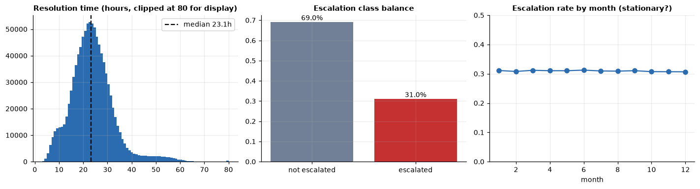
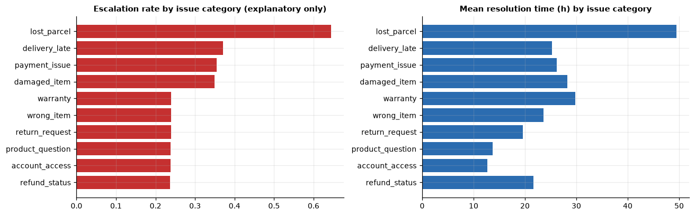
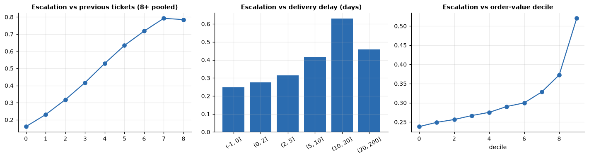
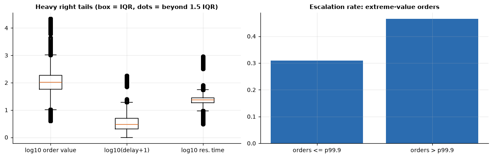
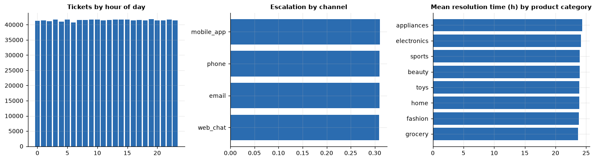
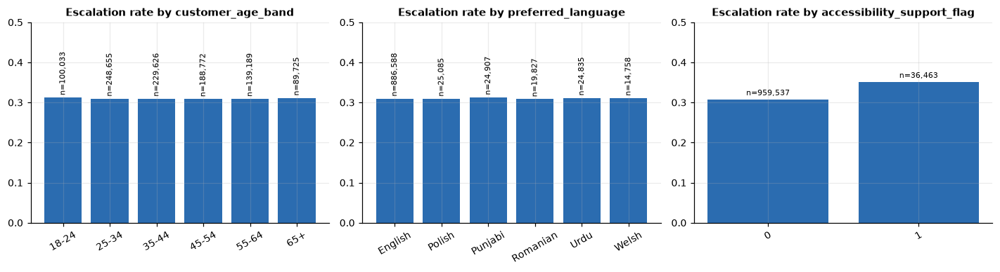
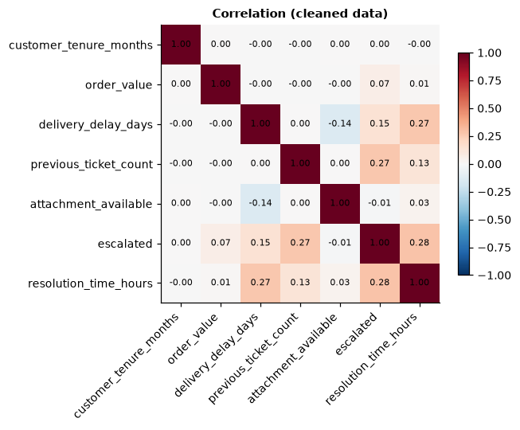
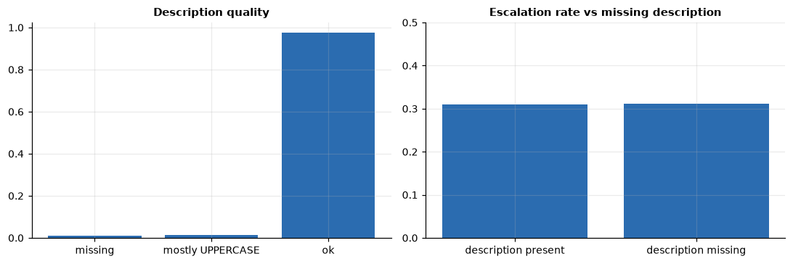

# EDA report

Generated by `scripts/02_eda.py` on the cleaned data (996,000 unique tickets). Each figure has one computed observation and one modelling/business implication. Numbers come from `artifacts/eda/eda_stats.json`.

## 1. Targets

**Observation.** Resolution time is right-skewed (median 23.1h, p99 54.7h, max 899h) and 31.0% of tickets escalate; the monthly escalation rate stays within 30.7%-31.2%.

**Implication.** Report MAE alongside RMSE (RMSE is dominated by a handful of extreme times), winsorise the training target, and use class weighting/PR-AUC rather than accuracy. A near-stationary rate supports a temporal split without drift correction.

## 2. Issue type is a major driver

**Observation.** 'lost_parcel' escalates 64% of the time and takes 49h on average, versus 24% for 'refund_status'.

**Implication.** Issue type must be available to the model. issue_category is assigned at triage (not T0), so the model uses the customer-entered issue_title (30 values) and message text as its legitimate proxy.

## 3. Prior contacts, delay and value

**Observation.** Escalation rises steadily with previous tickets (16% with none to 78% with 8+) and with order value (24% in the lowest decile to 52% in the highest). Delay is NOT monotone: 25% when on time, peaking at 63% for (10, 20] days late, then dropping to 46% beyond 20 days.

**Implication.** Previous tickets and order value are the main monotone T0 signals; the non-monotone delay curve is a reason to use tree ensembles (and delay bins/interactions for linear baselines) instead of assuming linearity. The >20-day drop is a small, heavy-tailed group and is treated cautiously.

## 4. Outliers

**Observation.** order_value reaches GBP 21,991 against a p99.9 of GBP 1,889; the extreme orders escalate 46% of the time (vs 31%).

**Implication.** Extremes are plausible rare high-value orders, not errors, so they are kept but winsorised at the TRAIN 99.9th percentile inside the pipeline (never using held-out quantiles); a log feature is added for linear models.

## 5. Time, channel, product

**Observation.** Ticket volume is almost flat across hours (CV 0.01); escalation differs by only 0.2% across channels and mean resolution time by 0.7h across product categories.

**Implication.** Calendar and channel features are cheap to keep but are expected to add little; the permutation-importance run in ml_classification confirms this rather than assuming it.

## 6. Subgroup imbalance

**Observation.** Age bands and languages escalate at near-identical rates, but accessibility-flagged customers escalate more (35.1% vs 30.8%) and are only 3.7% of tickets; Welsh/Romanian/Urdu/Punjabi/Polish speakers are each a few percent.

**Implication.** Sensitive attributes are kept out of the model (data minimisation) and used for per-subgroup error analysis; small groups get confidence intervals and an explicit sample-size caveat.

## 7. Linear structure

**Observation.** previous_ticket_count correlates 0.27 with escalation and delivery_delay_days correlates 0.27 with resolution time; tenure is uncorrelated with both.

**Implication.** Moderate linear signal supports a Ridge/logistic baseline; the remaining non-linear structure justifies tree ensembles. Tenure is kept only for the non-linear/interaction learners and tested in ablation.

## 8. Noisy text

**Observation.** 1.00% of descriptions are blank and 1.50% are mostly upper-case; messages carry template filler and noise footers (pls, thx, ASAP, '!!!').

**Implication.** Text pipelines lower-case and ignore filler; models receive a desc_missing flag instead of imputed text, and issue_title (never blank) backs up the text.

## Limitations

- The data is synthetic: relationships (e.g. flat hour-of-day volume, zero tenure effect) are generator properties, not evidence about real customers.
- Descriptive plots show association only; none of the patterns are causal claims.
- Issue-category plots use a triage-assigned field for *explanation only*; it is not a model input at T0 (see `reports/leakage_register.md`).
