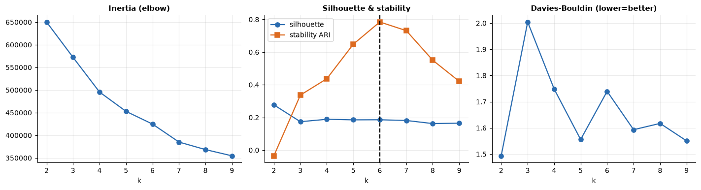
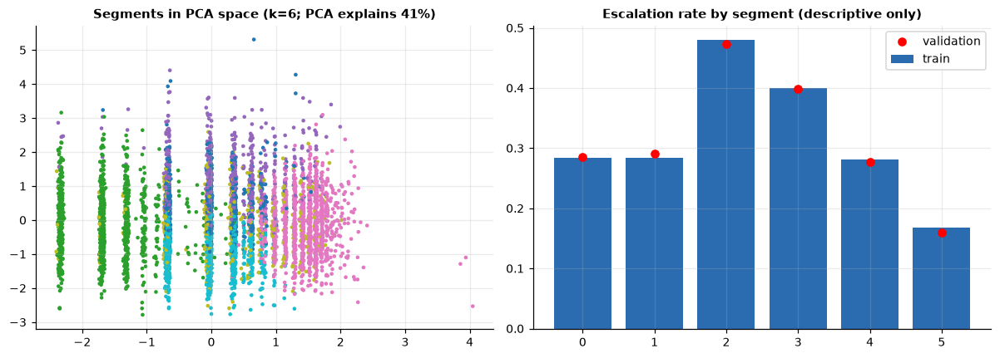

# Ticket segmentation and cautious personas

*Unit:* a ticket at creation (T0). *Features:* log order value, log delay, previous tickets (capped), tenure, attachment, issue family. *Method:* MiniBatchKMeans scan k=2..9, final KMeans k=6.
*Selection:* the highest-silhouette k among those with half-split stability ARI >= 0.7 and no cluster below 3% share. Chosen k=6: silhouette 0.186, stability ARI 0.784. See `artifacts/segmentation/k_selection.csv` and `fig_cluster_selection.png`.

## Personas (descriptive, not causal)

- **Segment 0** (18% of tickets; mostly 'account_payment_other' tickets, 48% of the segment): tickets that tend to show few previous contacts, higher-value orders. In training 28% escalate (overall 31%) and mean resolution time is 20.9h (overall 24.0h); validation shows 29% and 21.0h.
- **Segment 1** (18% of tickets; mostly 'damage' tickets, 38% of the segment): tickets that tend to show usually attach a file. In training 28% escalate (overall 31%) and mean resolution time is 24.6h (overall 24.0h); validation shows 29% and 24.7h.
- **Segment 2** (14% of tickets; mostly 'account_payment_other' tickets, 42% of the segment): tickets that tend to show frequent previous contacts. In training 48% escalate (overall 31%) and mean resolution time is 25.2h (overall 24.0h); validation shows 47% and 25.2h.
- **Segment 3** (20% of tickets; mostly 'delivery' tickets, 90% of the segment): tickets that tend to show long delivery delays. In training 40% escalate (overall 31%) and mean resolution time is 29.7h (overall 24.0h); validation shows 40% and 29.7h.
- **Segment 4** (10% of tickets; mostly 'account_payment_other' tickets, 36% of the segment): tickets that tend to show close to the overall average on the numeric features. In training 28% escalate (overall 31%) and mean resolution time is 22.8h (overall 24.0h); validation shows 28% and 23.0h.
- **Segment 5** (20% of tickets; mostly 'account_payment_other' tickets, 48% of the segment): tickets that tend to show few previous contacts, lower-value orders. In training 17% escalate (overall 31%) and mean resolution time is 20.2h (overall 24.0h); validation shows 16% and 20.2h.

## How far to trust these

- Silhouette 0.19 is modest: segments overlap and boundaries are soft; they are **useful groupings, not natural species**.
- Outcome columns were not used to form segments; train-vs-validation consistency is in `segment_consistency_train_vs_validation.csv`.
- Escalation/resolution differences are **associations**: a segment does not *cause* its outcome and these must not drive individual customer decisions.
- The data is synthetic; real-world segments would need re-validation, and sensitive attributes (age, language, accessibility) were deliberately excluded from clustering.
