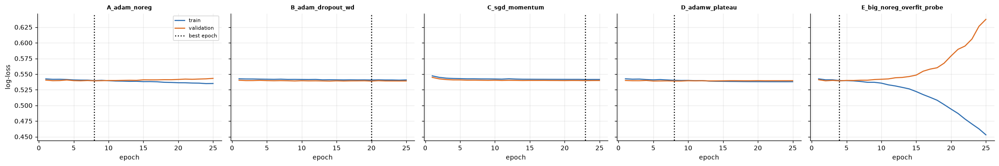

# Tabular neural network (escalation, T0 features)

Script `scripts/06_tabular_nn.py` · Evidence `artifacts/tabular_nn/` (histories, `config_comparison.csv`, `fig_learning_curves.png`) · Checkpoint `models/tabular_nn/best.pt` (+ `preprocessor.joblib`, `metadata.json`).

Same T0 features, temporal split and train-fitted preprocessing as the classical models; PyTorch MLP, weighted BCE, early-stopping on validation loss, best-epoch checkpoint.

| config | optimiser | hidden | dropout | weight decay | best epoch | val PR-AUC | final train loss | final val loss | gap (val−train) |
|---|---|---|---:|---:|---:|---:|---:|---:|---:|
| A | Adam | 128-64 | 0 | 0 | 8 | 0.574 | 0.535 | 0.543 | +0.008 |
| **B (selected)** | Adam | 128-64 | 0.3 | 0 | 20 | **0.575** | 0.541 | 0.539 | −0.002 |
| C | SGD+momentum | 128-64 | 0.3 | 0 | 23 | 0.571 | 0.541 | 0.540 | −0.002 |
| D | AdamW + plateau LR | 128-64 | 0.3 | 0.01 | 8 | 0.575 | 0.538 | 0.540 | +0.002 |
| E (overfit probe) | Adam | 512-512-256 | 0 | 0 | 4 | 0.575 | 0.453 | 0.637 | **+0.184** |

* **Overfitting is visible and controlled:** the 434k-parameter unregularised net (E) drives train loss to 0.45 while validation loss turns up after epoch 4 (gap +0.18); the small nets with dropout/weight decay show no gap. Early stopping at the best validation epoch is what keeps E's PR-AUC level.
* **Optimisers:** Adam and AdamW reach the same validation PR-AUC; SGD+momentum is slightly lower (0.571) after the same budget.
* **Frozen test (threshold 0.23 chosen on validation):** NN PR-AUC **0.5727**, ROC-AUC 0.7333 vs the selected classical model 0.5720 / 0.7337. **The network does not beat the classical models**; all agree because the signal is low-dimensional and mostly additive. Hence the deployed model is the tree/linear one (cheaper, calibrated, explainable).
* **Reproducibility:** re-running three epochs with the same seed gives identical validation loss (difference 0).
* Training took 4–9 minutes per configuration on CPU (shared with other jobs, so times are indicative only).
