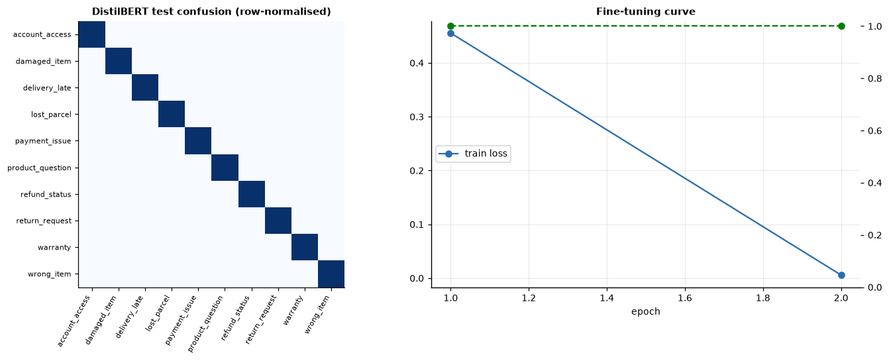

# Transformer fine-tuning vs TF-IDF (Session 22)

A real fine-tuning run of **distilbert/distilbert-base-uncased** (67M parameters) on `data/subsets/transformer_finetune_10000.parquet` for **2 epochs** (20.8 min on 12 CPU cores, no GPU), seed 42, batch 32, lr 5e-5, max length 64. Training rows: **6,932** (full 70% share - no hardware-driven reduction was needed); validation 1,486; held-out test **1,486**. TF-IDF + logistic regression was trained on the *same* training rows and scored on the *same* test rows.

| Model | Test split | Accuracy | Macro-F1 | Train time | ms / example |
|---|---|---|---|---|---|
| TF-IDF(1-2gram)+LogReg | test clean | 1.0000 | 1.0000 | 0s | 0.03 |
| DistilBERT fine-tuned | test clean | 1.0000 | 1.0000 | 1247s | 16.42 |
| TF-IDF(1-2gram)+LogReg | test noisy (typos/UPPERCASE) | 0.9913 | 0.9900 |  |  |
| DistilBERT fine-tuned | test noisy (typos/UPPERCASE) | 0.9017 | 0.9067 |  |  |

Paired outcome on the 1,486 test rows: both correct 1,486; only DistilBERT correct 0; only TF-IDF correct 0; both wrong 0.

## Reading the result honestly
- On clean text both models score 100% on all 1,486 held-out rows (templated messages), so the held-out set cannot separate them; there are no clean-text errors to analyse.
- On text with random typos and upper-casing the fine-tuned DistilBERT degrades much more (accuracy 0.902, macro-F1 0.907) than word/n-gram TF-IDF (0.991 / 0.990), the opposite of the usual expectation; the likely reason is that sub-word tokenisation of corrupted words is out-of-distribution when the model has only seen clean templates.
- Cost: DistilBERT took ~21 min to train on CPU and 16 ms/example at inference versus under 1 s and 0.03 ms for TF-IDF.
- Recommendation: serve TF-IDF as the default text classifier; keep the fine-tuned model as a documented real fine-tuning exercise, not a production improvement on this data.
